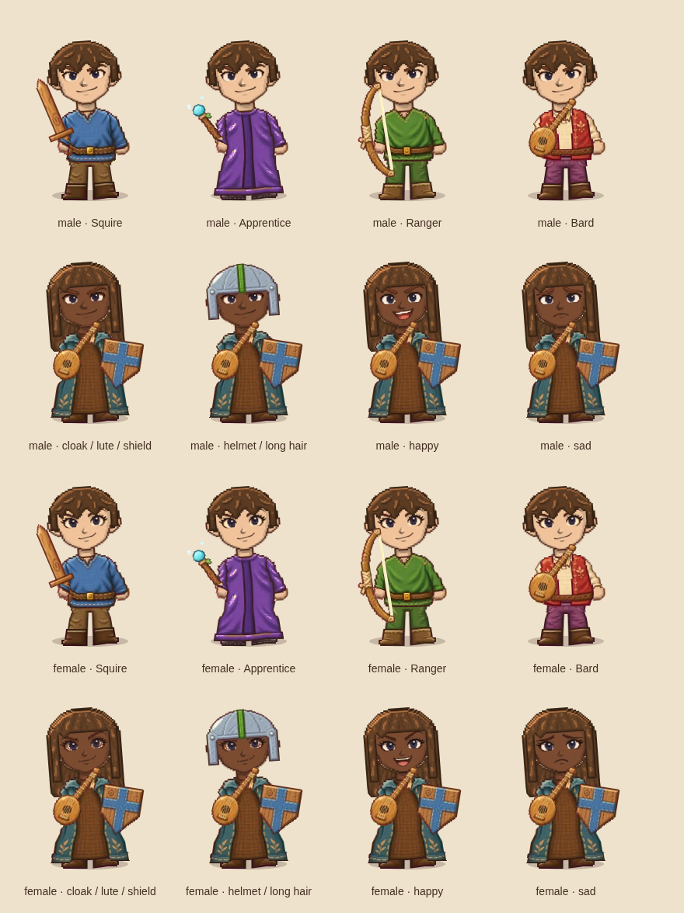

# Adventurous playable hero stance

The playable hero now leans over the planted leg, stands with feet farther apart and raises the holding forearm. Swords and wands point diagonally; long staves use a smaller angle to stay inside the canvas. The lute sits higher, across the torso with its neck below the face. Shields move with the other wrist.

Both hero versions, their expressions and the wardrobe use the same pose. Skin, hair, clothing, hats and face accessories are deformed together, so their registration is preserved. Held items are rotated rigidly around the wrist rather than bent with the arm. Fingers are composited over grips, while the lute, shields and books remain in front of the holding hand. Tall headgear has extra clearance above its tilted edge.

## Integration

`src/ui/heroPose.ts` defines the deformation and wrist transforms in the existing 192×256 equipment coordinate system. It uses a cached inverse lookup and premultiplied sampling to avoid joint cracks and dark transparent edges. Maps are shared by poses with the same arm shape rather than duplicated for every skin, colour or item ID.

The pose is applied to the assembled figure in `heroArtUrl`, after the existing male/female clothing fit and colour choices. `heroUrl(..., true)` applies the same stance to the code fallback while painted art loads. `HeroSprite` and `HeroBust` opt in; the default code renderer used by rival figures and wardrobe icons keeps its original registration. Pets, saves, unlock conditions and item IDs are unchanged.

This is a static illustrated stance using the existing art layers. It adds no save setting or continuous animation. It does not redraw the character from a new viewing angle.

## Verification

- Unit checks: all held items retain their dimensions and attach to the corresponding wrist; the feet spread, the arms lift and the head stays registered across equipment choices. A regression check reserves space for tall hats.
- `npm run build` and `npm test` validate the application and existing save/equipment behavior.
- `npx playwright test e2e/hero.spec.ts` exercises the production hero creator, both body choices, all starter classes and persistence.
- `node tools/art/check-hero.mjs http://localhost:5173 /tmp/hero-stance.png` checks the painted render of every item on both bodies (114 cases), all hairstyles and skin/eye combinations, expressions and colour changes. It also exercises the code fallback and rejects painted sprites whose opaque pixels touch the canvas edge.
- Add `equipment` as the final argument to capture a larger visual gallery including each held item and head accessory. The normal sheet includes cloak, long hair, helmet, lute and shield combinations.
