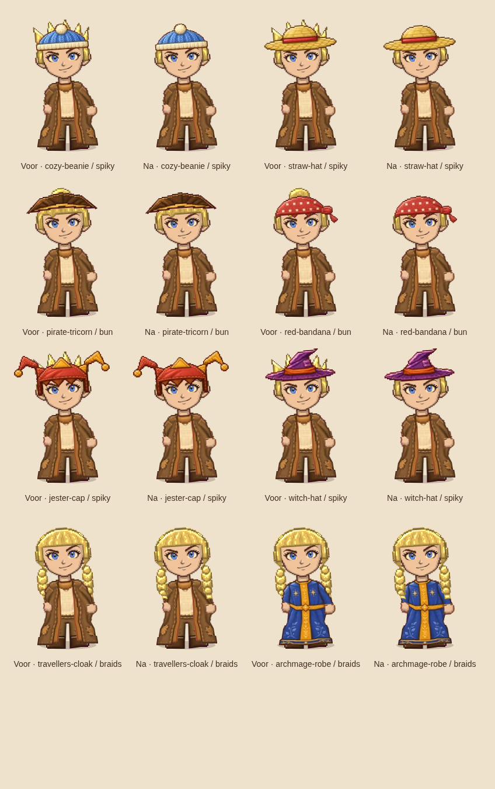

# Hero equipment combination audit



The audit found and corrected two layer-order defects:

- Buns and spikes could protrude through the beanie, bandana, straw hat, witch hat, jester cap and tricorn. These closed caps now constrain the top of the hairstyle. Crowns and feathers remain open; helmets and hoods continue to hide hair. The painted hero and player code fallback use the same policy.
- The ends of front braids disappeared under cloaks and robes because all lower hair was behind clothes. Braids now hang over the shoulders, ahead of clothing and behind hands. Loose long hair and ponytails remain behind clothes.

## Coverage

`tools/art/check-hero-combinations.mjs` renders the following matrices on both male and female heroes. The male cases use skin 3; female cases use skin 6. The separate hand regression covers all six skin tones.

| Matrix | Render cases |
| --- | ---: |
| Headgear (including none) × ten hairstyles × twelve garments × two bodies | 2,880 |
| Headgear × hairstyles × four face accessories × two bodies | 960 |
| Headgear × garments × face accessories × two bodies | 1,152 |
| Garments × main-hand choices (including none) × off-hand choices (including none) × two bodies | 3,744 |
| Garments × seven leg items × two bodies | 168 |
| **Total** | **8,904** |

Every render must load its painted layers and keep opaque pixels away from the canvas edge. In addition:

- 3,072 closed-headgear pixel comparisons check that changing the hairstyle cannot add pixels above the cap or outside a fully covering hood/helmet.
- 240 braid comparisons check that clothing cannot replace the opaque lower braid pixels. The reference keeps the same headgear, face and pose with the garment removed.
- The existing 480 hand checks still verify exposed hands with ten ordinary garments, both bodies, six skin tones and empty/sword-held hands.
- The production build, 94 unit tests and the production Playwright hero creation/edit/reload test pass.

The script produces a JSON report and gallery sheets for every group. Representative sheets were visually inspected for open/closed hats, face accessories, cloaks, robes, fur, armour, swords, long staves, shields, books and the lute. The image above contains eight paired before/after examples.

## Repeating the audit

Start the Vite dev server, then run:

```sh
node tools/art/check-hero-combinations.mjs http://localhost:5173 /tmp/hero-combinations
node tools/art/check-hero-hands.mjs http://localhost:5173 /tmp/hero-hands.png
```

The combination script uses a fresh page per group to bound the renderer caches and fails on missing art, browser errors, canvas clipping or the defined occlusion regressions. Its report is saved as `report.json` alongside the gallery sheets. The committed [report snapshot](hero-combination-report.json) records this audit.

This is exhaustive within the matrices above, not the full Cartesian product of six equipment slots, every colour and every expression. Automatic checks cannot decide whether every possible overlap is artistically desirable; new equipment or additional reported cases should extend the visual examples and regressions.
