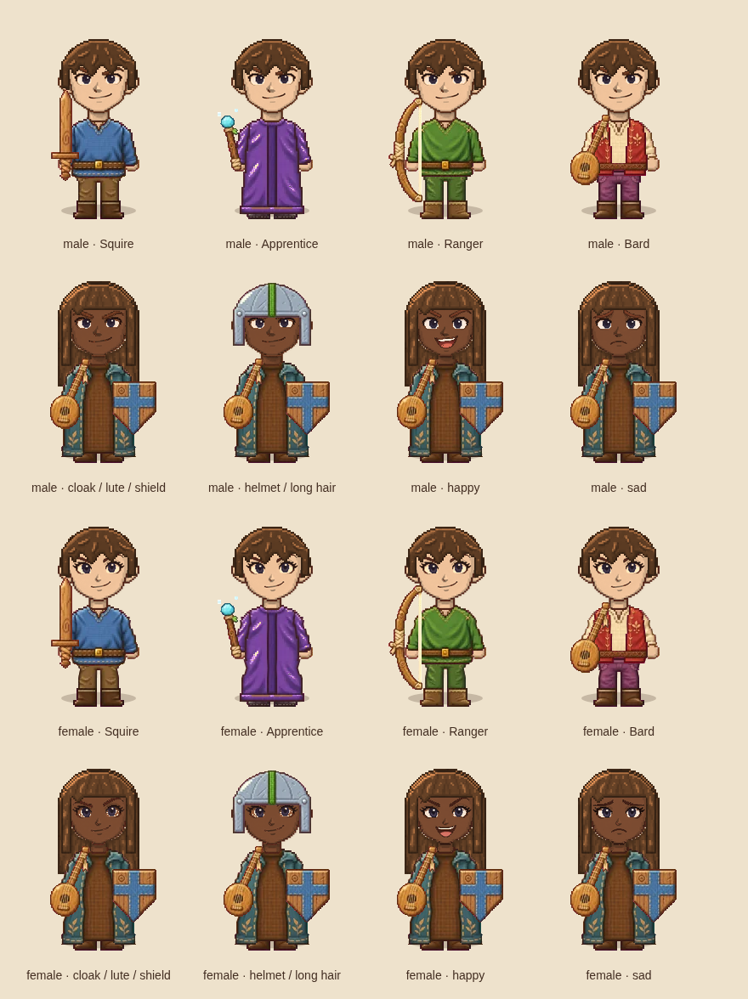

# Playable hero prototype

The hero creator now offers male and female versions with more expressive painted faces and a shared wardrobe. Both versions support all four starter classes, all hairstyles, six skin tones, hair colours and eye colours. Each has idle, happy and sad expressions.

## Equipment compatibility

The equipment canvas remains 192×256 (the existing 48×64 design at 4×). Item IDs, unlock rules and save version are unchanged. `HeroLook.body` is optional; missing values use the male fit. Changing this choice only changes the look and keeps the equipped items, class and progress.

`src/ui/heroRig.ts` records the shared head, neck, shoulder, waist, hand and foot anchors. The female fit narrows the shoulder/waist regions slightly; the same row transform applies to the base and body/leg clothing. Head, neck, hands and feet remain registered. The code fallback uses the same fit envelope. Handheld items and headgear keep their original coordinates.

Long hair below the neck is composited behind the body and clothing; the fringe is drawn over the face. Headgear, face accessories and held items retain their foreground order. Hoods and helmets hide hair using the existing equipment rules.

The six new head layers live in `public/art/hero/v2`. Warm skin pixels are recoloured separately from eye whites, irises and outlines. Iris recolouring and cache keys include the body, expression and skin colour. The existing portraits and rival figures are unaffected.

## Art sources

`tools/art/hero-v2-source` contains the generated transparent source heads: one idle head and a two-column happy/sad sheet per version. `python tools/art/prepare-hero-heads.py tools/art/hero-v2-source` crops their alpha bounds and registers each head at `(48,30)` with a 96×94 bounding box. It requires Pillow. These are modular face layers, not complete character illustrations.

This first prototype keeps the shared standing pose and existing equipment paintings. The more dynamic stance and diagonal weapon poses from the concept sheet would need another equipment registration pass. The current fit is a small shared variation, not 57 separately repainted clothing variants.

## Validation

- `npm run build` — TypeScript and production build.
- `npm test` — includes legacy-save round trips, preservation of equipment and fixed anchors.
- `npx playwright test e2e/hero.spec.ts` — production browser flow: both versions, four classes, hair/skin/eye choices, editing and persistence after reload.
- With the Vite dev server running: `node tools/art/check-hero.mjs http://localhost:5173 /tmp/hero-preview.png` — actual canvas rendering of all 57 items on both bodies, all 10 hair choices per body, 48 skin/eye combinations, colour changes, expressions and the legacy default. Captures the class/equipment review sheet and fails on missing art or browser errors.

The review sheet includes long hair with the cloak, helmet, shield and lute. The rendering checks establish asset coverage; they do not replace visual review of every possible wardrobe combination.
